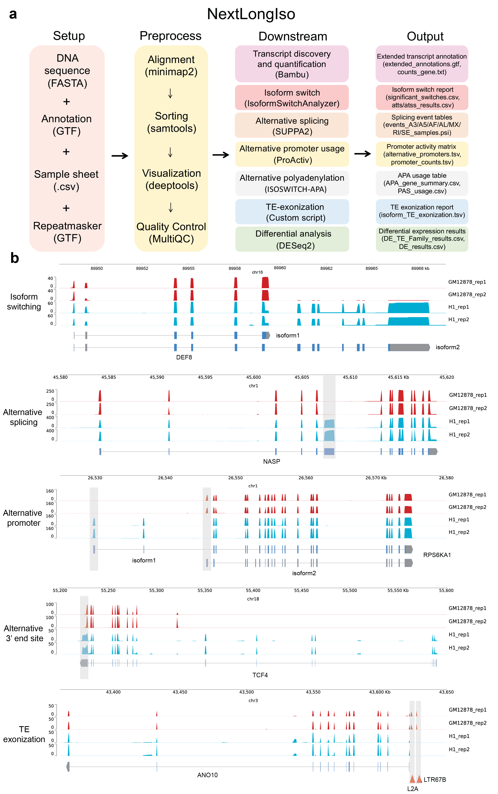

# 🧬 NextLongIso: a comprehensive Nextflow pipeline for multi-dimensional long-read RNA-seq analysis

NextLongIso is a modular Nextflow pipeline for streamlined, reproducible, and scalable analysis of long-read RNA-seq data from PacBio Iso-Seq and Oxford Nanopore platforms. It integrates all major analysis steps, from read alignment and bigWig generation to isoform quantification, alternative splicing, alternative polyadenylation (APA), alternative promoter usage, and repeated sequences (simple repeats and TE) analysis, by using state-of-the-art tools and custom scripts.

🧭 **Workflow Overview**

Below is the schematic overview of the NextLongIso pipeline:



Figure 1. Overview of the NextLongIso pipeline, showing read alignment, isoform quantification, alternative promoter usage, APA, alternative splicing, and repeats (simple repeats and TE) exonization/differential expression analysis.

✳️ **Key Features**

* **End-to-end automation** of long-read RNA-seq analysis, starting from FASTQ files or from aligned BAM files.
* **Supports multiple platforms:** Fully compatible with both **PacBio** and **Nanopore** long-read data.
* **Integrated analysis tools:** Utilizes minimap2, samtools, deepTools, Bambu, DESeq2, IsoformSwitchAnalyzeR, SUPPA2, proActiv, bedtools and custom scripts.
* **Containerized environment:** Singularity/Apptainer or Docker, with pinned BioContainers images.
* **Validated inputs:** parameters and the samplesheet are checked before anything runs (`--help` lists every option).
* **Laptop to HPC:** resource caps (`--max_cpus`, `--max_memory`, `--max_time`), automatic retries with more memory, and ready-made SLURM and LSF profiles.
* **Customizable tools:** extra options for minimap2, bamCoverage, Bambu, SUPPA2 and proActiv without editing the code.

🆕 **What's new in v0.2.0**

Version 0.2.0 adds parameter/samplesheet validation, a pre-built minimap2 index and streaming alignment, full support for BAM input, gene- and transcript-level differential expression, a configurable reference condition, multi-condition comparisons, a new exon-based TE quantification with per-isoform TE annotation, HPC profiles, a test profile and CI, and fixes several bugs (for example, SUPPA2 PSI values were almost all `nan` because transcript IDs did not match). See [CHANGELOG.md](CHANGELOG.md) for the full list, including **breaking changes**.

🧩 **Installation**

To run NextLongIso, you need **Nextflow (≥ 25.10.0)** and **Apptainer/Singularity** (or Docker). Internet access is required on the first run to download the [nf-schema](https://github.com/nextflow-io/nf-schema) plugin (version 2.7.3, the last release that supports Nextflow 25.10) and to pull the containers (several GB in total).

**1. Environment Setup**: Use Conda to install the dependencies required to run the pipeline:

```bash
# Create and activate environment
conda create -n nf-LongIso -c conda-forge -c bioconda \
    nextflow=25.10.0 \
    apptainer \
    openjdk=17 \
    graphviz \
    -y
```

**2. Pipeline Installation**

```bash
conda activate nf-LongIso

git clone https://github.com/YidanSunResearchLab/nf-LongIso.git

cd nf-LongIso
```

You can also run a released version directly, without cloning: `nextflow run YidanSunResearchLab/nf-LongIso -r v0.2.0 ...`.

**3. Check the installation** (tiny test dataset of ~16 MB downloaded from Zenodo; about 2 minutes once the containers are downloaded; works from any directory):

```bash
nextflow run YidanSunResearchLab/nf-LongIso -r v0.2.0 -profile test,singularity --outdir results_test
# or, from a clone:
nextflow run /path/to/nf-LongIso/main.nf -profile test,singularity --outdir results_test
```

The test data (record https://zenodo.org/records/21074209) are cut from the demo run by `tests/make_test_data.sh`; they are not stored in the repository.

🚀 **Quick Start for demo test**

**1. Prepare Reference Files (GRCh38/hg38 as example)**
```bash
mkdir -p data/genome
cd data/genome

wget https://ftp.ebi.ac.uk/pub/databases/gencode/Gencode_human/release_47/GRCh38.primary_assembly.genome.fa.gz

gunzip GRCh38.primary_assembly.genome.fa.gz

wget https://ftp.ebi.ac.uk/pub/databases/gencode/Gencode_human/release_47/gencode.v47.annotation.gtf.gz

gunzip gencode.v47.annotation.gtf.gz

wget -O TEtranscript_hg38_rmsk_TE.gtf "https://zenodo.org/records/21074209/files/TEtranscript_hg38_rmsk_TE.gtf?download=1"
```

**Important Note**: If you choose to use your own Genome FASTA or GTF files, ensure they all originate from the same genome assembly (e.g., GRCh38/hg38). Additionally, chromosome nomenclature must be consistent across all files (e.g., ensure all files use chr1 consistently rather than mixing chr1 and 1). Mismatched assembly versions or inconsistent naming conventions are the most frequent causes of pipeline failure. We recommend inspecting the file headers before starting to verify that these attributes align.

**2. Start**

Navigate to the project directory and execute the pipeline using the command below. Note that the file paths are relative to the project root; ensure your reference files are correctly placed in the **data/genome/** directory.

```bash
cd nf-LongIso

nextflow run main.nf \
  -profile singularity \
  --input_type fastq \
  --genome data/genome/GRCh38.primary_assembly.genome.fa \
  --gtf data/genome/gencode.v47.annotation.gtf \
  --te_gtf data/genome/TEtranscript_hg38_rmsk_TE.gtf \
  --samplesheet demo/samplesheet.csv \
  --outdir results \
  -resume
```

Understanding the Flags:  \
**-profile singularity**: Uses Singularity/Apptainer containers to ensure software reproducibility (`-profile docker` uses Docker)  \
**--input_type**: Defines the data format (`fastq`, or `bam` for aligned reads)  \
**-resume**: This allows the pipeline to pick up exactly where it left off if a run is interrupted  \
**--genome**, **--gtf**, **--te_gtf**: Paths to the reference files (`--te_gtf` is optional and enables the TE analysis)  \
**--samplesheet**: CSV file listing the samples (see **Samplesheet** below)  \
**--outdir**: Output directory (default `results`)

Run `nextflow run main.nf --help` for the main options, `--helpFull` for all of them, and `--help <parameter>` for details on one parameter. Execution reports (resource usage, timeline, trace, DAG) are always written to `<outdir>/pipeline_info/`.

**Note**: During the first run, the pipeline will download required containers, which may take some time depending on your internet connection. We recommend using the -resume flag for all future executions, it intelligently tracks progress and reuses successful results, drastically reducing runtime.

**3. Resources and HPC**

Every task asks for a fixed amount of CPU and memory (memory and time grow automatically when a task is retried after running out of memory). No single task ever asks for more than:

| Parameter | Default | Meaning |
|---|---|---|
| `--max_cpus` | `16` | CPUs per task |
| `--max_memory` | `128.GB` | Memory per task |
| `--max_time` | `72.h` | Run time per task |

The defaults are sized so that the demo also runs on a 16-core / 64 GB machine. On a large server, raise them (e.g. `--max_cpus 32 --max_memory 256.GB`).

To submit tasks to a cluster, combine a container profile with an executor profile:

```bash
# LSF (example: WashU RIS compute cluster)
nextflow run main.nf -profile singularity,lsf \
  --hpc_queue general --hpc_cluster_options="-G compute-<group>" \
  --samplesheet samplesheet.csv --genome genome.fa --gtf annotation.gtf --outdir results

# SLURM
nextflow run main.nf -profile singularity,slurm \
  --hpc_queue <partition> --hpc_cluster_options="--account=<account>" \
  --samplesheet samplesheet.csv --genome genome.fa --gtf annotation.gtf --outdir results
```

Run the Nextflow command itself on a login/interactive node (or inside a long-running job); it submits one job per task. Apptainer converts images in its temporary directory; if `/tmp` is small, set `export APPTAINER_TMPDIR=/path/with/space` before starting Nextflow.

📋 **Samplesheet**

A CSV file with a header line and one row per sample:

| Column | Required | Description |
|---|---|---|
| `sample` | yes | Unique sample name |
| `condition` | yes | Biological condition / group |
| `fastq` | with `--input_type fastq` | FASTQ file (`.fastq`, `.fq`, optionally `.gz`) |
| `bam` | with `--input_type bam` | Coordinate-sorted BAM file |
| *other columns* | no | Covariates such as `batch` or `sex`, used when named in `--design` (see **Experimental design and covariates**) |

```csv
sample,fastq,condition
GM12878_rep1,demo/GM12878_demo_rep1.fastq.gz,control
GM12878_rep2,demo/GM12878_demo_rep2.fastq.gz,control
H1_rep1,demo/H1_demo_rep1.fastq.gz,treatment
H1_rep2,demo/H1_demo_rep2.fastq.gz,treatment
```

Rules (checked before the run starts):
* `sample` and `condition` must start with a letter and contain only letters, digits and underscores (`^[A-Za-z][A-Za-z0-9_]*$`). Dots and hyphens are not allowed because R and DESeq2 silently rewrite such names, which breaks the matching between count tables and samples.
* Sample names must be unique, and every input file must exist. Relative paths are resolved from the directory where you start Nextflow.
* Conditions with fewer than 2 replicates produce a warning; isoform-switch testing and SUPPA2 diffSplice skip them.
* **Reference condition:** all comparisons are made against `--reference_condition`. If it is not set, `control` is used when present, otherwise the alphabetically first condition. The log shows which one was used.
* **BAM input** (`--input_type bam`): BAMs must be coordinate-sorted. A BAM index (`<file>.bam.bai` or `<file>.bai`) is used when present and created otherwise. Each BAM is renamed to `<sample>.sorted.bam` inside the pipeline, so all result tables use the sample names. Alignment statistics, junctions and bigWigs are produced exactly as for FASTQ input. `--genome` is still required (Bambu uses it).

⚙️ **Customizing tool parameters**

Extra options are **appended after** the pipeline's own options, so you can add options and, for tools where a later option wins, override defaults.

| Parameter | Default | Tool / step | Description |
|---|---|---|---|
| `--minimap2_preset` | `splice` | minimap2 index + alignment | `-x/-ax` preset; use `splice:hq` for PacBio Iso-Seq / high-accuracy reads |
| `--minimap2_args` | *(empty)* | minimap2 alignment | Appended after `-ax <preset> -t <cpus> [--junc-bed] --secondary=no` |
| `--minimap2_junc_bed` | `true` | minimap2 alignment | Guide alignment with junctions from `--gtf` |
| `--minimap2_index` | *(none)* | minimap2 | Pre-built `.mmi` index (skips index building) |
| `--minimap2_index_args` | *(empty)* | minimap2 index | Index-building options such as `-k`, `-w`, `-H` |
| `--bamcoverage_args` | *(empty)* | deepTools bamCoverage | Appended after `--binSize 5 --minMappingQuality 5 --normalizeUsing CPM --skipNonCoveredRegions` |
| `--bambu_args` | *(empty)* | Bambu | Extra R arguments for `bambu()`, e.g. `NDR = 0.1` |
| `--suppa2_events` | `SE SS MX RI FL` | SUPPA2 generateEvents | Event types |
| `--suppa2_diff_args` | `-m empirical -gc` | SUPPA2 diffSplice | See **Differential splicing (SUPPA2)** |
| `--sqanti3_args` | *(empty)* | SQANTI3 QC | Extra `sqanti3_qc.py` options (see **SQANTI3**) |
| `--design` | `~ condition` | all differential analyses | Design formula over samplesheet columns (see **Experimental design and covariates**) |
| `--reference_condition` | *(auto)* | all differential analyses | Reference group (see Samplesheet) |
| `--isoswitch_alpha` | `0.05` | IsoformSwitchAnalyzeR | q-value cutoff for isoform switches |
| `--isoswitch_dif_cutoff` | `0.1` | IsoformSwitchAnalyzeR | Minimum \|dIF\| for `significant_switches.csv` |
| `--isoswitch_consequences`, `--isoswitch_n_plots` | `true`, `10` | IsoformSwitchAnalyzeR | See **Isoform switch consequences** |
| `--usage_alpha` | `0.05` | DEXSeq (APA, promoters) | Gene-level q-value cutoff for differential PAS and promoter usage |
| `--junction_min_mapq` | `0` | junction extraction | See **Junctions** |
| `--apa_*`, `--promoter_*`, `--tss_*` | | APA, promoter usage | See **Alternative polyadenylation (APA)** and **Promoter usage** |
| `--skip_read_qc`, `--run_sqanti3` | `false`, `false` | read QC, SQANTI3 | See **Read QC** and **SQANTI3** |
| `--proactiv_species` | `Homo_sapiens` | proActiv (`--promoter_method proactiv`) | Species for the standard-chromosome filter (see below) |
| `--proactiv_altprom_args` | `minAbs = 0.25, minRel = 0.05, maxPval = 0.05, promoterFC = 2.0, geneFC = 1.5` | proActiv `getAlternativePromoters()` | Thresholds for alternative promoters |
| `--te_count_mode`, `--te_min_overlap`, `--te_strand`, `--te_autonomous_frac` | `exon`, `20`, `sense`, `0.5` | TE analysis | See **TE quantification modes** |

`--proactiv_species` accepts the species known to GenomeInfoDb: `Homo_sapiens`, `Mus_musculus`, `Rattus_norvegicus`, `Canis_familiaris`, `Drosophila_melanogaster`, `Caenorhabditis_elegans`, `Saccharomyces_cerevisiae`, `Arabidopsis_thaliana`, `Oryza_sativa`, `Zea_mays`, `Populus_trichocarpa`, `Gossypium_hirsutum`, `Cyanidioschyzon_merolae`.

**Command line.** Write `--param="value"` (with `=`): a value that starts with `-` (such as `-G 500k`) would otherwise be read by Nextflow as a separate option.

```bash
nextflow run main.nf -profile singularity \
  --samplesheet samplesheet.csv --genome genome.fa --gtf annotation.gtf --outdir results \
  --minimap2_preset=splice:hq \
  --minimap2_args="-G 500k --splice-flank=no" \
  --bamcoverage_args="--binSize 10 --normalizeUsing RPKM" \
  --bambu_args="NDR = 0.1" \
  --reference_condition=control
```

**Custom config.** Options can also be set per process in a config file passed with `-c`. A value set this way replaces the corresponding `--*_args` parameter.

```groovy
// custom.config
process {
    withName: MINIMAP2_ALIGN { ext.args = '-G 500k --splice-flank=no' }
    withName: MINIMAP2_INDEX { ext.args = '-k 14' }
    withName: MAKE_BIGWIG    { ext.args = '--binSize 10 --normalizeUsing RPKM' }
    withName: BAMBU          { ext.args = 'NDR = 0.1' }
    withName: PROACTIV       { ext.args = 'minAbs = 0.1, minRel = 0.05, maxPval = 0.05, promoterFC = 1.5, geneFC = 2.0' }
}
```

```bash
nextflow run main.nf -profile singularity -c custom.config --samplesheet samplesheet.csv --genome genome.fa --gtf annotation.gtf --outdir results
```

**Notes**
* Options are appended, so a later option overrides an earlier one where the tool allows it (e.g. `--minimap2_args="--secondary=yes"` overrides `--secondary=no`; `--bamcoverage_args="--binSize 10"` overrides `--binSize 5`). The full minimap2 command is printed in each alignment task's `.command.log`.
* Index-building options (`-k`, `-w`, `-H`) only work in `--minimap2_index_args`; in `--minimap2_args` they have no effect because the index is already built. A pre-built `--minimap2_index` must come from the same genome and preset.
* Changing a parameter changes the affected task scripts: with `-resume`, those steps and everything downstream of them run again, and all other steps are reused.
* `--bambu_args` is inserted into R code: use double quotes for R strings (e.g. `--bambu_args='opt.discovery = list(prefix = "Tx")'`); single quotes are rejected. Do not repeat arguments that the pipeline already sets (`reads`, `annotations`, `genome`, `ncore`, `discovery`, `quant`, `lowMemory`, `verbose`).
* To use alignments made with your own settings, start from BAM files with `--input_type bam`.

🧪 **Experimental design and covariates**

All differential analyses (DESeq2 for genes, transcripts and TEs, IsoformSwitchAnalyzeR, and the DEXSeq usage tests for APA and promoters) use the design formula `--design` (default `~ condition`). Covariates are extra samplesheet columns named in the formula, with `condition` as the last term:

```csv
sample,fastq,condition,batch
GM12878_rep1,reads/GM12878_rep1.fastq.gz,control,b1
GM12878_rep2,reads/GM12878_rep2.fastq.gz,control,b2
H1_rep1,reads/H1_rep1.fastq.gz,treatment,b1
H1_rep2,reads/H1_rep2.fastq.gz,treatment,b2
```

```bash
nextflow run main.nf -profile singularity --samplesheet samplesheet.csv --design '~ batch + condition' ...
```

* Covariates are categorical (factors). Their values follow the naming rule of conditions, and a column with a single value is rejected.
* The design matrix is checked before alignment starts: a confounded design (e.g. every `treatment` sample in one batch) stops the run with a message naming the samplesheet columns involved.
* DESeq2 and IsoformSwitchAnalyzeR use the formula directly. The DEXSeq usage tests use `~ sample + exon + <covariate>:exon + condition:exon` against `~ sample + exon + <covariate>:exon`.
* SUPPA2 diffSplice and proActiv's `getAlternativePromoters()` do not model covariates; a warning is printed when covariates are set.

🔗 **Junctions**

Splice junctions are extracted from every sample's primary alignments (`samtools view -F 2308`, MAPQ ≥ `--junction_min_mapq`, default 0). The junction strand comes from the minimap2 `ts` tag (transcript strand relative to the read, combined with the alignment strand), or from `XS` when present; junctions without either tag get strand `.`. `junctions/<sample>.junctions.bed` (BED6; score = min(reads, 1000)) and `junctions/<sample>.junctions.tsv` (chr, start, end, strand, reads, motif, annotated) use 0-based, end-exclusive intron coordinates. `motif` is the intron's dinucleotide pair in transcript orientation (`GT-AG`, `GC-AG`, `AT-AC` or `non-canonical`; for strand `.`, the orientation that gives a canonical motif) and `annotated` tells whether the intron is in `--gtf`. The TE analysis only uses junctions on the transcript's strand or with unknown strand (`.`).

📍 **Alternative polyadenylation (APA)**

`apa/` replaces the v0.1.0 APA output of IsoformSwitchAnalyzeR (`isoswitch/APA_gene_summary.csv`, `clustered_base_level_PAS_usage.csv`, which used scaled isoform fractions and a Fisher test without replicates).

1. **PAS sites.** The 3' ends of the Bambu transcripts are clustered per gene and strand: ends closer than `--apa_cluster_window` (25 bp) join a cluster, and clusters are split so that no cluster is wider than `--apa_max_cluster_width` (50 bp).
2. **Internal priming.** The 3' end of a novel transcript is flagged when the 20 nt downstream are ≥ `--apa_ip_a_frac` (0.7) A or contain a run of 6 A, unless an annotated 3' end lies within 50 bp or a poly(A) signal hexamer (AATAAA, ATTAAA and 10 variants) lies 10–40 nt upstream. Flagged ends are removed (`--apa_internal_priming filter`, default) or kept and marked (`flag`). Annotated ends are never removed.
3. **Usage test.** PAS read counts (Bambu transcript counts summed per cluster; clusters with < `--apa_min_count` reads are removed) are tested with DEXSeq for each condition vs the reference, with the design covariates. Genes with gene-level q < `--usage_alpha` have differential PAS usage.

Outputs: `pas_transcripts.tsv` (every transcript end with its A content, PAS signal and filter decision), `pas_annotation.tsv`, `pas_counts.tsv`, `apa_dexseq_results.tsv` (per PAS: padj, gene q, PAS usage per sample and condition, dPAU) and `APA_gene_summary.csv` (per gene: top PAS, `pas_shift_bp` = change of the usage-weighted mean PAS position in transcription direction, `direction` distal/proximal). Method comparison with v0.1.0: `docs/dev/apa_method_comparison.md`.

🚦 **Promoter usage**

`--promoter_method tss` (default) defines promoters from the Bambu transcripts' 5' ends, clustered per gene and strand (`--tss_cluster_window` 50 bp, maximal width `--tss_max_cluster_width` 100 bp), so single-exon transcripts and novel TSSs are included. Promoter counts are the Bambu counts of the transcripts starting in each cluster. Activity follows proActiv: absolute activity = log2(normalised count + 1) with DESeq2 size factors from the gene counts, relative activity = promoter count / gene count, and each promoter is Major (most active of its gene), Minor or Inactive (absolute activity < `--promoter_min_activity`, 0.25) per condition; internal promoters (inside another transcript of the gene) are classified too and flagged in `internal_promoter`. Differential promoter usage uses DEXSeq as for APA (`--promoter_min_count`, `--usage_alpha`).

`--promoter_method proactiv` runs proActiv on junction files built from the BAMs, as in v0.1.0. proActiv quantifies a promoter from the reads of its first intron, so promoters of single-exon transcripts are never quantified (NA), and it does not model covariates.

Outputs (`promoter/`): `promoter_annotation.tsv`, `promoter_counts.tsv`, `promoter_activity.tsv`, `promoter_dexseq_results.tsv` and `alternative_promoters.tsv` (promoters of genes with gene q < `--usage_alpha`); with `proactiv`: `promoter_activity.tsv`, `promoter_counts.tsv`, `alternative_promoters.tsv` in proActiv's format. ONT cDNA reads are often truncated at the 5' end, which can move or split TSS clusters; use CAGE data, where available, to confirm TSS-level results. Method comparison: `docs/dev/promoter_method_comparison.md`.

🔀 **Isoform switch consequences**

With `--isoswitch_consequences true` (default), transcript sequences are extracted from the Bambu annotation with gffread, IsoformSwitchAnalyzeR predicts ORFs (`analyzeORF`, longest ORF) and `analyzeSwitchConsequences` compares the up- and down-regulated isoforms of each significant switch for intron retention, ORF similarity, NMD status, TSS, TTS, last exon, isoform length and exon number. No BSgenome package is needed. Outputs in `isoswitch/`: `switch_consequences.csv`, `consequence_summary.csv/.pdf` (`extractConsequenceSummary`), `consequence_enrichment.csv/.pdf` (`extractConsequenceEnrichment`) and `switch_plots.pdf` (`switchPlot` of the top `--isoswitch_n_plots` switching genes, 10 by default). Without significant switches these files contain a message instead. External tools (CPC2, Pfam, SignalP, IUPred2A) are not run.

✂️ **Differential splicing (SUPPA2)**

SUPPA2 generates splicing events from the Bambu annotation and computes PSI per sample from the Bambu transcript counts. PSI is a ratio of transcript abundances within a gene, so PSI values from counts and from CPM are identical. With `--suppa2_diff true` (default), `suppa.py diffSplice` compares each non-reference condition with the reference (options `--suppa2_diff_args`, default `-m empirical -gc`; Bambu CPM values are passed as the transcript expression). It needs at least 2 replicates in both conditions; other conditions are skipped with a warning, and it does not model covariates.

Outputs (`suppa2/diffsplice/`): `<condition>_vs_<reference>_<event type>.dpsi` (ΔPSI = condition − reference, p-value) and `.psivec` (PSI per sample), and `suppa2_diffsplice_significant.tsv` (all comparisons and event types, p < `--suppa2_alpha` 0.05 and |ΔPSI| > `--suppa2_dpsi_cutoff` 0.1). With few replicates the empirical method can report p = 0 for events with ΔPSI near 0; the |ΔPSI| cutoff removes them from the combined table.

📊 **Read QC**

For FASTQ input, NanoPlot (read length and quality distributions, interactive HTML) and `seqkit stats --all` (read number, N50, quality) run on every sample (`read_qc/nanoplot/<sample>/`, `read_qc/seqkit/<sample>.seqkit_stats.tsv`); both summaries are included in the MultiQC report. `--skip_read_qc` turns this off; with BAM input it is not run.

🏷️ **SQANTI3**

With `--run_sqanti3` (off by default), SQANTI3 QC (`sqanti3_qc.py` only; no filter or rescue) classifies every transcript of the Bambu annotation against `--gtf`. It uses the official container `anaconesalab/sqanti3:v6.0.1` (about 7.5 GB to download). Outputs (`sqanti3/`): `nextlongiso_classification.txt`, `nextlongiso_junctions.txt`, `nextlongiso_SQANTI3_report.html` and `sqanti3_category_counts.tsv` (number of transcripts per structural category: FSM, ISM, NIC, NNC, genic, antisense, fusion, intergenic, genic intron; all, annotated and novel transcripts). Extra options go in `--sqanti3_args` (e.g. `--sqanti3_args='--report skip'`; orthogonal data such as `--CAGE_peak` or `--polyA_motif_list` need paths that are visible inside the container). The test profile runs SQANTI3 only as a stub.

🧬 **TE quantification modes**

With `--te_gtf`, NextLongIso links Bambu isoforms to transposable elements (TEs) and quantifies TE-derived expression. Two counting modes are available:

| | `--te_count_mode exon` (default) | `--te_count_mode span` |
|---|---|---|
| Overlap tested | Isoform **exons** vs TE, at least `--te_min_overlap` bp (default 20) | Whole isoform **span** (first to last base, including introns) vs TE |
| Strand | `--te_strand sense` (default) or `both` | Same strand only |
| Isoform overlapping several TEs | Counted once for each TE subfamily / instance it overlaps | Counted for only one of them (the last overlap reported) |
| Use | Recommended for new analyses | Comparison with the v0.1.0 counting rule |

**Why the default changed.** A TE inside an intron is not part of the mature transcript, but the span mode counts every read of the host transcript for it. Span-mode TE counts therefore largely mirror host-gene expression (see `docs/te_count_mode_comparison.md`), whereas the exon mode only counts transcripts that actually contain TE sequence, and counts each one for every subfamily/instance it contains.

Both modes produce `TE_family_counts.tsv` and `TE_instance_counts.tsv` with the same columns, and the same TE differential expression. Independently of the mode (it is new in v0.2.0), `TE/isoform_TE_annotation.tsv` lists every (isoform, TE instance) pair whose exonic overlap, summed over the isoform's exons, is ≥ `--te_min_overlap`, with the TE subfamily, family and class, the coordinates, the overlap length, the TE fraction of the isoform, the strand relation (`--te_strand both` also reports antisense TEs), a category, `exon_positions` and `junction_supported`.

`category` is assigned by the first rule that applies, in this order of priority. Each exon-level rule is evaluated for one exon at a time: that exon alone must overlap the TE by at least `--te_min_overlap` bp. First and last exon are defined in transcription order (on the minus strand the first exon is the rightmost one), not by `exon_number`.

| Category | Definition |
|---|---|
| `autonomous` | The TE covers at least `--te_autonomous_frac` (default 0.5) of the isoform's exonic length |
| `TSS` | The TE overlaps the first exon (in transcription order) by ≥ `--te_min_overlap` bp |
| `PAS` | The TE overlaps the last exon by ≥ `--te_min_overlap` bp |
| `internal_exonization` | The TE overlaps an internal exon by ≥ `--te_min_overlap` bp |
| `other_exonic` | No single exon overlaps the TE by `--te_min_overlap` bp; the pair only reaches the threshold when the overlaps of several exons are added up (e.g. a TE spanning an intron and touching the ends of two exons by a few bp each) |

`exon_positions` lists every exon position the TE touches (any overlap, `first`, `internal`, `last`, separated by `;`; a single-exon isoform is `first;last`), so overlaps that did not decide the category are still visible. `junction_supported` is `yes` when every splice site of the touched exons matches an observed junction (±5 bp), `no` otherwise, and `NA` for single-exon isoforms.

`TE/isoform_TE_exonization.tsv` keeps the strict definition of TE exonization: a novel exon outside all annotated exons, at least 90 % covered by a same-strand TE, whose two boundaries both match junctions observed in the reads (±5 bp). Each boundary must match a junction **endpoint**, so novel terminal exons (a TE-derived first or last exon has only one splice site) are not listed here; they appear in `isoform_TE_annotation.tsv` as `TSS`, `PAS` or `autonomous`. The annotation and exonization tables do not depend on `--te_count_mode`. With BAM input, junctions are extracted as well, so this works for both input types.

**Published results**: to reproduce the results of the paper (v0.1.0) exactly, run that version with `-r v0.1.0` (see Citation). `--te_count_mode span` only switches the TE counting rule back to the v0.1.0 one, for comparison with the exon mode.

📂 **Output**

After a successful run, NextLongIso generates the following output directories and representative files.

| Output folder  | Output files | Description |
| -------------- | ------------ | ----------- |
| **minimap2/**  | `*.sorted.bam`, `*.sorted.bam.bai`, `*.sorted.bam.stats`, `*.sorted.bam.flagstat` | Sorted and indexed alignments (FASTQ input) and alignment statistics (both input types). SAM files are no longer written. |
| **bigwig/**    | `*.bw` | BigWig coverage tracks for genome browser visualization (e.g., IGV, UCSC Genome Browser). |
| **read_qc/**   | `nanoplot/<sample>/`, `seqkit/<sample>.seqkit_stats.tsv` | Read QC (FASTQ input; see **Read QC**). |
| **junctions/** | `*.junctions.bed`, `*.junctions.tsv` | Splice junctions per sample with strand, read count, motif and annotation status (see **Junctions**). |
| **bambu/**     | `extended_annotations.gtf`, `counts_gene.txt`, `counts_transcript.txt`, `CPM_transcript.txt`, `bambu_annotations.rds`, `bambu_results.rds` | Transcript annotation, gene/transcript expression quantification, and Bambu objects. |
| **DE_genes/**  | `DE_results.csv`, `normalized_counts.csv`, `pca_plot.pdf` | Gene-level differential expression (from `counts_gene.txt`). With more than two conditions: `DE_results_<condition>_vs_<reference>.csv`. |
| **DE_transcripts/** | `DE_results.csv`, `normalized_counts.csv`, `pca_plot.pdf` | Transcript-level differential expression (from `counts_transcript.txt`). |
| **isoswitch/** | `significant_switches.csv`, `isoform_switch_results.csv`, `atts_results.csv`, `atss_results.csv`, `all_AS_events.csv`, `switch_consequences.csv`, `consequence_summary.csv/.pdf`, `consequence_enrichment.csv/.pdf`, `switch_plots.pdf`, `switchlist.rds` | Isoform switches (q < `--isoswitch_alpha` and \|dIF\| > `--isoswitch_dif_cutoff`), alternative TSS/TTS, alternative splicing and switch consequences per comparison (`condition_1` = reference). |
| **apa/**       | `pas_transcripts.tsv`, `pas_annotation.tsv`, `pas_counts.tsv`, `apa_dexseq_results.tsv`, `APA_gene_summary.csv` | Poly(A) sites and differential PAS usage (see **Alternative polyadenylation (APA)**). |
| **promoter/**  | `promoter_annotation.tsv`, `promoter_counts.tsv`, `promoter_activity.tsv`, `promoter_dexseq_results.tsv`, `alternative_promoters.tsv` | Promoter activity and differential promoter usage (see **Promoter usage**; replaces `proactiv/`). |
| **suppa2/**    | `events_A3/A5/AF/AL/MX/RI/SE_*.ioe`, `psi/`, `diffsplice/` | Alternative splicing events, PSI (Percent Spliced In) values (`*_filtered.psi` keeps events with a PSI value in at least two samples) and differential splicing (see **Differential splicing (SUPPA2)**). |
| **sqanti3/**   | `nextlongiso_classification.txt`, `nextlongiso_junctions.txt`, `nextlongiso_SQANTI3_report.html`, `sqanti3_category_counts.tsv` | SQANTI3 structural categories of the Bambu transcripts (`--run_sqanti3`). |
| **TE/**        | `TE_family_counts.tsv`, `TE_instance_counts.tsv`, `isoform_TE_annotation.tsv`, `isoform_TE_exonization.tsv` | TE expression, per-isoform TE annotation and strict TE exonization events (see **TE quantification modes**). |
| **TE/DE/**     | `DE_TE_Family_results.csv`, `DE_TE_Instance_results.csv`, `norm_counts_*.csv`, `pca_*.pdf`, `volcano_*.pdf` | Differential expression of TE subfamilies and individual TE instances. |
| **multiqc/**   | `multiqc_report.html`, `multiqc_report_data/` | Read QC, alignment statistics, numbers of differentially expressed genes/transcripts and software versions. |
| **pipeline_info/** | `execution_report_*.html`, `execution_timeline_*.html`, `execution_trace_*.txt`, `pipeline_dag_*.html`, `software_versions.yml` | Resource usage, run timeline, task trace, workflow graph and the exact version of every tool. |

**Note**: Some output files (e.g., `alternative_promoters.tsv`, `APA_gene_summary.csv`) are only written when the corresponding events are detected. With a single condition, differential analyses write a file with a `Message` column explaining why they were skipped.

💡 **Troubleshooting**

* **Validation error at start-up?** The message names the parameter or samplesheet row and the rule that failed (e.g. a sample name containing `-`).
* **Pull fails?** Check your internet connection and ensure your Singularity/Apptainer version is up to date (≥ 3.8).
* **Reference mismatch?** Ensure your FASTA and GTF are from the exact same assembly build.
* **A task ran out of memory?** It is retried automatically with more memory, up to `--max_memory`; raise `--max_memory` if the limit is reached.
* **Something failed?** The log prints the work directory of the failed task; check its `.command.err` and `.command.log`, fix the cause and rerun with `-resume`.

🛠 **Maintenance and Support**

NextLongIso is actively maintained by the Sun Lab. We are committed to maintaining and improving the software.
Maintenance activities include:
* Updating software dependencies
* Fixing reported bugs
* Improving compatibility with new systems and sequencing technologies
* Implementing usability improvements when appropriate

We also welcome community contributions. Users are encouraged to:
* Report issues via the GitHub **Issues** page
* Suggest new features
* Contribute improvements through **Pull Requests**

Changes between versions are listed in [CHANGELOG.md](CHANGELOG.md). Continuous integration (`.github/workflows/ci.yml`) checks the parameter schemas, lints the code, runs unit tests of the TE and APA analyses and stub runs of the test profile (default settings, and with `--run_sqanti3` and a design covariate) on every push and pull request.

While we aim to maintain long-term support for NextLongIso, development priorities may evolve as the software and research needs grow.

🧾 **Citation**

If you use NextLongIso in your work, please cite:

Tan J. et al. (2026). **NextLongIso: a comprehensive Nextflow pipeline for multi-dimensional long-read RNA-seq analysis.** Bioinformatics. https://academic.oup.com/bioinformatics/advance-article/doi/10.1093/bioinformatics/btag518/8750111.
* **The individual tools used within the pipeline:** minimap2, samtools, deepTools, Bambu, SUPPA2, IsoformSwitchAnalyzeR, DEXSeq, proActiv, DESeq2, gffread, bedtools, NanoPlot, seqkit, SQANTI3 (optional), MultiQC, etc.

The paper describes NextLongIso **v0.1.0**. To run exactly that version:

```bash
nextflow run YidanSunResearchLab/nf-LongIso -r v0.1.0 -profile singularity \
  --input_type fastq --samplesheet samplesheet.csv \
  --genome genome.fa --gtf annotation.gtf --te_gtf TE.gtf
```

Please state the version you used (shown at the top of the log and in `pipeline_info/software_versions.yml`).

⚖️ **License**

MIT LICENSE.
